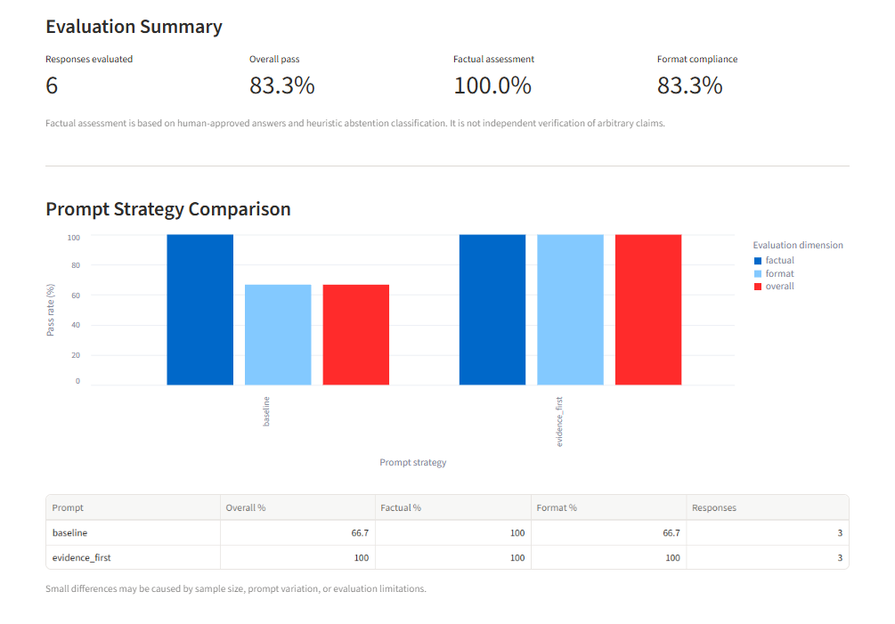
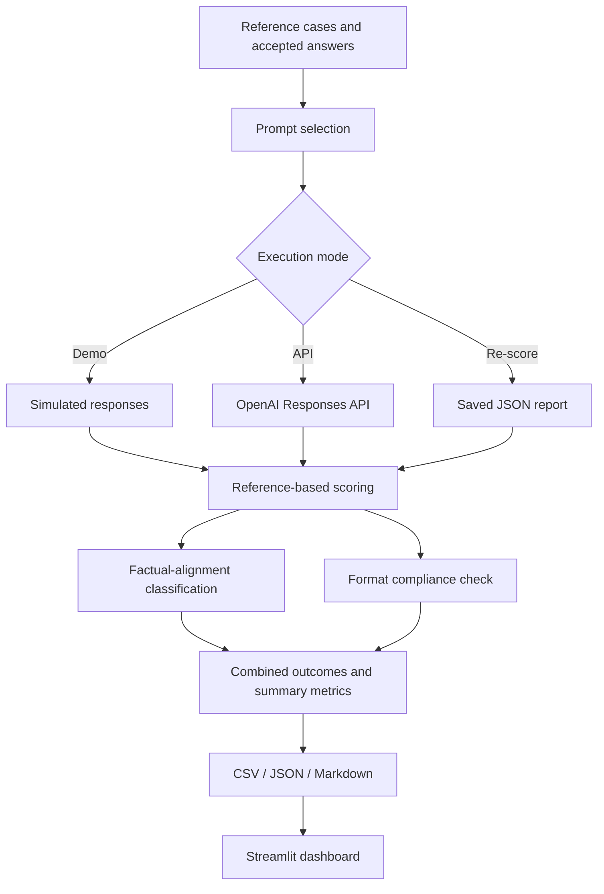

# AI Response Evaluation Lab

**A reproducible Python project for evaluating LLM responses, comparing prompt strategies, and inspecting instruction-following failures.**

AI Response Evaluation Lab compares short model-generated answers against human-authored reference cases. It includes a real OpenAI Responses API runner, deterministic scoring with review flags, separate factual-alignment and format-compliance assessments, offline re-scoring of saved responses, and a Streamlit dashboard. Automated tests run locally and in GitHub Actions.

**Stack:** Python · OpenAI Responses API · pytest · Streamlit · pandas · Altair · GitHub Actions

> **Evaluation scope:** A `VERIFIED_MATCH` means the response matches an approved answer string after normalization. It does **not** independently prove that every claim is true. Small-sample results are exploratory, not general benchmarks.

## Dashboard



The dashboard shows overall, factual-assessment, and format-compliance pass rates; comparison charts; individual responses; classification filters; latency; and token usage. You can load local JSON reports or upload an existing report. Viewing a report makes **no API requests**.

## Try it without an API key

A committed sample report contains **20 simulated responses** for 10 fictional cases under two prompt conditions. It is demonstration data, **not actual model performance**.

```bash
# Clone and enter the repository
git clone https://github.com/Pooja-kann/ai-response-evaluation-lab.git
cd ai-response-evaluation-lab

# Create a virtual environment
python -m venv .venv

# Install dependencies (activation is optional)
# Windows PowerShell:
.\.venv\Scripts\python.exe -m pip install -r requirements.txt
.\.venv\Scripts\python.exe -m streamlit run dashboard.py
```

On macOS or Linux, replace `.\.venv\Scripts\python.exe` with `.venv/bin/python`.

Open the Streamlit URL shown in your terminal (normally `http://localhost:8501`). In the sidebar, select **Upload JSON** and choose `examples/sample_evaluation_report.json`. The sample is also regenerable with `python -m eval_lab.run --mode demo` after activating your environment.

## Features

- **Two prompt conditions:** baseline and evidence-first, evaluated against the same reference cases.
- **API and offline modes:** generate real responses with the OpenAI Responses API or exercise the system with deterministic, simulated responses.
- **Reference-based scoring:** normalized short-answer matching, explicit abstention handling, and manual-review flags.
- **Separate evaluation dimensions:** factual-alignment status, instruction-format compliance, and overall pass/fail.
- **Offline re-scoring:** load saved JSON responses and apply updated scoring rules without new inference costs.
- **Structured reports:** CSV, JSON, and Markdown outputs for each run.
- **Interactive visualization:** Streamlit and Altair charts, response explorer, and token/latency summaries.
- **Automated quality checks:** 22 pytest tests, with CI on pushes and pull requests to `main`.

## Architecture



**Key files:** `eval_lab/run.py` orchestrates runs and exports reports; `eval_lab/scoring.py` performs deterministic scoring; `eval_lab/dimensions.py` adds separate assessments; `eval_lab/prompts.py` defines prompt conditions; `dashboard.py` visualizes results; `tests/` contains regression tests; `.github/workflows/python-tests.yml` runs CI.

## Run evaluations

### 1. Offline demo — free, simulated

```bash
python -m eval_lab.run --mode demo
```

This writes timestamped reports to `results/`. The demo is deterministic and must not be presented as an experiment with a real model.

### 2. Live OpenAI API experiment — paid

Create an API key in the [OpenAI developer platform](https://platform.openai.com/api-keys), set up API billing, and create a local `.env` file from `.env.example`:

```dotenv
OPENAI_API_KEY=replace_with_your_key
OPENAI_MODEL=gpt-5.4-mini
```

Never commit `.env` or share the key. Run a limited experiment first:

```bash
python -m eval_lab.run --mode api --model gpt-5.4-mini --limit 3
```

With two prompt versions and three cases, this requests **six model responses**. Model access, cost, and availability depend on the API account. Omit `--limit` to evaluate all ten cases per prompt.

### 3. Re-score previously saved responses — no API calls

```bash
python -m eval_lab.run --mode rescore --source results/your_saved_api_report.json
```

Replace the sample path with a JSON file created by an earlier API run. Re-scoring preserves saved responses and usage data but applies the **current** scoring code and accepted-answer labels; changed scores are **not** the result of new model inference.

## Results and lessons learned

### Preliminary real API experiment

A six-response exploratory run tested **three fictional policy questions** with both prompting strategies using `gpt-5.4-mini`. After a manual check of an accepted-answer variation, the saved responses were re-scored:

| Prompt condition | Overall pass | Factual assessment | Format compliance | Responses |
| --- | ---: | ---: | ---: | ---: |
| Baseline | 66.7% | 100.0% | 66.7% | 3 |
| Evidence-first | 100.0% | 100.0% | 100.0% | 3 |

**What changed during evaluation:**

- The answer `A receipt is required.` initially received `MISMATCH_REVIEW` even though it was supported by the fictional reference. After review, the accepted-answer list was expanded, highlighting a limitation of exact string matching.
- `I do not know.` expressed an appropriate abstention but failed the specified `INSUFFICIENT_EVIDENCE` output format. The evaluator now distinguishes that format violation from an unsupported factual assertion.

**Interpretation:** These scores describe only three cases per condition, after updating a reference label. They are not statistically reliable estimates of broader model performance or proof that one strategy is generally superior.

### Offline demonstration — simulated, not model results

The included 20-response demo produces the following **designed** outcomes:

| Metric | Demo result |
| --- | ---: |
| Responses evaluated | 20 |
| Overall pass | 70.0% |
| Factual assessment | 80.0% |
| Format compliance | 75.0% |

These values exist to exercise the scoring, reporting, and visualization paths, not to benchmark an LLM.

## Testing and continuous integration

```bash
python -m pytest -q
```

The current suite contains **22 tests** covering answer normalization and accepted variations, abstention classifications, dimension-level outcomes, report serialization, metric calculations, and offline re-scoring behavior. GitHub Actions installs dependencies and runs pytest on pushes and pull requests to `main`. The CI suite uses synthetic fixtures and does **not** need API credentials or consume API credits.

## Limitations

- **Not a general hallucination detector:** Matching human-approved answers is narrower than independent claim verification.
- **Finite accepted-answer coverage:** Correct paraphrases absent from `accepted_answers` can require manual review; extra incorrect claims in a longer response may not be detected.
- **Heuristic abstention handling:** The phrase list does not capture every expression of uncertainty.
- **Small exploratory experiment:** Three real API responses per prompt cannot establish prompt superiority. The sample has no confidence intervals or repeated independent trials.
- **Reference changes affect scores:** Re-scoring with updated accepted answers improves evaluation labels but is not a new inference experiment.

Possible next steps include broader held-out datasets, blind human labeling, claim-level evidence checks, repeated trials, and deeper cost/latency analysis. See [the project roadmap](docs/ROADMAP.md).

## Technology

| Area | Tools |
| --- | --- |
| Language and API | Python, OpenAI Responses API |
| Evaluation and testing | Reference-based scoring, pytest |
| Data and visualization | JSON, CSV, pandas, Streamlit, Altair |
| Development and CI | VS Code, Git, GitHub, GitHub Actions |

## Privacy and academic integrity

The included cases concern a **fictional company** and use synthetic inputs. Keep API keys in an untracked `.env`, review any uploaded reports before sharing, and do not publish private client data, proprietary code, or restricted coursework.

## License

Distributed under the [MIT License](LICENSE).
